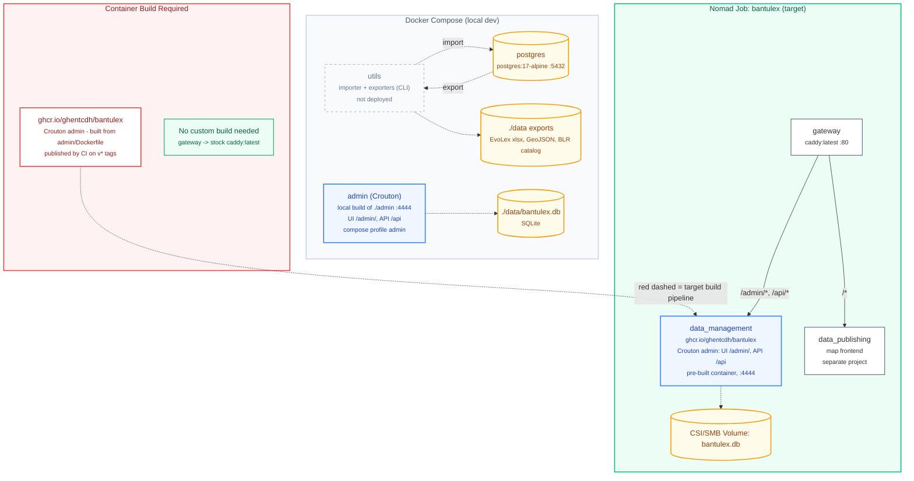

# BantuLex Architecture

This document describes the structure and deployment architecture of the BantuLex project, matching the transition from Docker Compose (local development) to Nomad (target production environment).

## Infrastructure Overview

Notes:

- Local dev has no gateway: the admin is reached directly on `127.0.0.1:4444`, and the exporters write their files to `data/`. The map that uses those exports lives in a separate project.
- The admin has no login: in production it must sit behind an authenticating reverse proxy. Its UI base path is `/admin/` and its API `/api` (see `admin/README.md`); serving it under another sub-path requires changing that configuration.
- Known gap: the importer writes to Postgres (`DATABASE_URL` in `utils/utils.env`), while the admin edits the SQLite file `bantulex.db`. Nothing currently syncs the two; a Postgres datasource for the admin is future work.

## Legend

- ■ **Custom container (needs CI/CD build)**
- ■ **Stock / config-only container**
- ◌ **Dev-only (not deployed)**
- ■ **Persistent data**
- --- **The one required build pipeline**

## Data Model & Normalization

The BantuLex data model follows specific normalization rules to handle complexities in linguistic data while maintaining a clean relationship structure.

### 1. Fieldwork & Consultants

Previously stored as comma-separated strings, data collectors and consultants are now fully normalized:

- **`DataCollector`**: Unique persons who collected the data.
- **`Consultant`**: Unique persons who provided the linguistic information.
- **Link Tables**: `FieldworkDataCollector` and `FieldworkConsultant` handle the Many-to-Many relationship, allowing multiple collectors and consultants to be linked to a single fieldwork session without duplication or string-parsing issues.

### 2. Source Tracking & Ordering

To avoid the anti-pattern of slot-based roles (e.g., `role="second_source"`), the system uses a unified role system combined with explicit ordering:

- **Roles**:
  - `primary`: A direct source for the lexical entry.
  - `cited`: A source cited within a primary source.
- **Ordering**: The `order` column in `SourceEntries` preserves the sequence of sources from the spreadsheet (1, 2, 3...).
- **Exporting**: Exporters (like EvoLex) aggregate all `primary` sources for an entry into a single field, ensuring no bibliographic data is lost.

### 3. BLR Phonological Structures

Phonological positions (C1, V11, T11, etc.) for Bantu Lexical Reconstructions are kept as fixed columns. This is a deliberate choice to support the "Sound Search" (Klankzoeker) in the map (a separate project, fed by `just export-blr`), which requires predictable structural slots.
