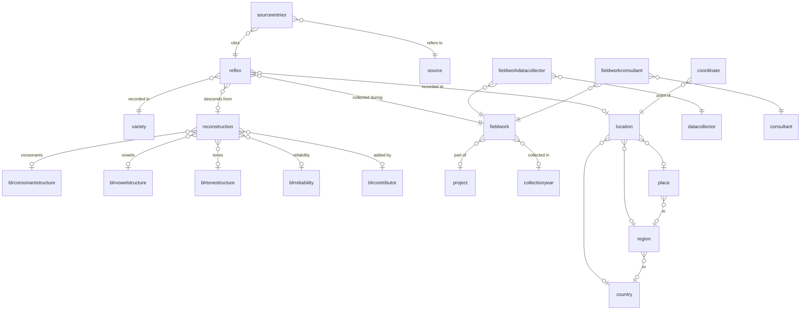

# Data model

BantuLex is a comparative lexical database of Bantu languages. Its centre is the
link between words recorded in present-day language varieties (**reflexes**) and
the Proto-Bantu roots they descend from (**reconstructions**, from the BLR
dataset). All other tables describe where, when, by whom and from which
publication a word was recorded.

The canonical model is [`utils/utilities/src/utilities/model.py`](../utils/utilities/src/utilities/model.py).
The importer writes it to Postgres. Every table there has `id`, `created_at` and
`updated_at`; the SQLite export used for publishing has no timestamp columns
(see [publishing](publishing.md)).

Row counts below are from the export of 2026-10-12. "Excel column" is the column
of the source spreadsheet that the importer reads.

## Lexical data

### `reflex` (185,148 rows)

One word as recorded in one language variety. In historical linguistics a
reflex is the present-day form that continues an older root.

| Column | Excel column | Meaning |
| --- | --- | --- |
| `original_id` | `ID 20250825` | Row ID in the spreadsheet version of 2025-08-25. |
| `beginning_id` | `ID beginning` | Stable business ID, unique. The importer reports duplicates. |
| `term` | `Term` | The form as written. A leading `-` marks a stem without its prefix (`-bul`); a prefix is split off with a hyphen (`i-pfi`, noun class prefix `i-`). |
| `term_morph_analysis` | | Morphological analysis of the term (`+bul`). |
| `translation` | `Translation` | Gloss in the language of the source (French, Dutch, Latin, ...). |
| `meaning` | `Meaning` | English gloss. |
| `scientific_name` | `Scientific name` | Taxon name for plants and animals. |
| `semantic_field` | `Semantic field` | Semantic category. |
| `part_of_speech` | `Part of Speech` | Word class. |
| `blr_index` | `BLR Index` | The BLR number as written in the spreadsheet (text). |
| `blr_entry_id` | | Foreign key to the matching `reconstruction`, resolved from `blr_index`. |
| `ipa`, `notes_on_ipa` | `IPA`, `Notes on IPA` | Phonetic transcription and notes on it. |
| `notes` | `Opmerking` | Free remarks. |
| `variety_id`, `location_id`, `fieldwork_id` | | Where, by whom and when the word was recorded. |

Column fill rate: `meaning` 69%, `term_morph_analysis` 39%, `blr_entry_id` 46%,
`part_of_speech` 15%, `semantic_field` 11%, `ipa` almost never (51 rows).

### `reconstruction` (10,252 rows)

One entry of the BLR (*Bantu Lexical Reconstructions*) dataset: a reconstructed
Proto-Bantu root. The importer reads it from `data/BLR.xlsx`; reflexes come from
`data/bantulex.xlsx`.

| Column | Excel column | Meaning |
| --- | --- | --- |
| `blr_index` | `Index` | The BLR number. `reflex.blr_index` refers to this value. |
| `word_tone` | `Word\Tone` | The root with tone marks (`bʊ́d`). |
| `word` | `Word` | The root without tone marks (`bʊd`). |
| `english`, `french` | `English`, `Français:` | Glosses. |
| `noun_class` | `N class` | Singular/plural noun class pairs, for nouns (`5/6, 7/8`). |
| `distribution` | `Distr:` | Guthrie zones where the root is attested (`A B C D H K L R S`). |
| `note` | `Note` | Remarks. |
| `proto_kk` | `Proto KK` | Unknown, and empty in the current export. See [data quality](data-quality.md). |
| `date_of_entry` | `Date of entry` | When the entry was added to BLR. |
| `contributor_id` | `Added by` | Person who added the entry (`blrcontributor`, 4 rows). |
| `reliability_id` | `Fiab:` | Reliability score (`blrreliability`, 29 distinct values). |
| `*_structure_id` | | Phonological profile, see below. |

### `blrconsonantstructure`, `blrvowelstructure`, `blrtonestructure`

The consonants (`c1` to `c4`), vowels (`v11`, `v12`, `v21`, `v22`, `v3`, `v4`)
and tones (`t11` to `t4`, values `H` or `L`) of a root, in fixed positions. Equal
profiles are shared between reconstructions. The fixed positions exist for the
sound search (Klankzoeker) of the map: "all roots with `b` in C1 and `a` in V1".
`blrconsonantstructure.cs` comes from Excel column `CS`; its meaning is unknown.

### `variety` (1,670 rows)

A language or dialect, together with its classification.

| Column | Excel column | Meaning |
| --- | --- | --- |
| `name_english`, `name_french`, `name_bantu` | `Variety (English)`, `variety (French)`, `Variety (Bantu)` | Names. `name_bantu` is the name in the language itself (`Kidiŋ-Kamtsha`). |
| `name_bastin` | `Variety as named in Bastin` | Name used in Bastin et al. 1999. |
| `branch` | `Branch` | Main genealogical branch, e.g. *West-Coastal Bantu*. |
| `branch_detailed` | `Branch (detailed)` | Full subgroup path, joined with `_`. |
| `guthrie_index` | `Guthrie Index` | Guthrie's referential code: `B86` is zone B, group 80, language 6. |
| `guthrie_plus` | `Guthrie PLUS` | Extended Guthrie code for varieties without their own code (`B86S`, `B501X`). |
| `bastin_index` | `Bastin Index` | Code in Bastin et al. 1999. |
| `substrate_suspect` | | 1 when the variety may have a non-Bantu substrate. |

A row is a combination of name and classification, not a unique language: the
1,670 rows have 1,200 distinct English names.

## Provenance

- **`source`** (741): a publication or archive, as `author_year` plus `title`.
  `year_uncertain` is 1 when the year is not certain.
- **`sourceentries`** (190,308): links a reflex to its sources. `role` is
  `primary` (the word comes from this source) or `cited` (a source that the
  primary source cites). `order` keeps the spreadsheet order (1 to 3), and
  `pages` is the page reference.
- **`fieldwork`** (257): one data collection event, with `project`,
  `collectionyear`, `archive` and `data_entered_by` (initials).
- **`collectionyear`** (44): a year and its `status`: `known`, `uncertain`
  (written with `?` in the source) or `unknown` (then `value` is empty).
- **`datacollector`** (59) and **`consultant`** (120): the researchers who
  collected the data and the speakers who gave it. `fieldworkdatacollector` and
  `fieldworkconsultant` are the many-to-many join tables.
- **`project`** (11): the research project.

## Geography

- **`location`** (506): one combination of `place`, `region` and `country`.
  Each part is optional.
- **`place`** (442), **`region`** (97), **`country`** (19): the place names.
  `region` is the fieldwork region within a country.
- **`coordinate`** (536): a point for a location. `description` is `default`
  (the point to use, possibly corrected; Excel `Latitude`/`Longitude`) or
  `original` (as given in the source; Excel `Latitude OR source`/`Longitude OR
  source`). `coordinate_source` names where the point comes from. 130 locations
  have both.

## Storage

The SQLite export from Dataflow uses only `TEXT`, `INTEGER` and `REAL`, and its
tables are not STRICT. Booleans such as `substrate_suspect` and `year_uncertain`
are stored as `INTEGER` 0/1.

The design choices behind this model (normalized persons, source roles with
order, fixed BLR slots) are explained in [ARCHITECTURE.md](../ARCHITECTURE.md#data-model--normalization).
